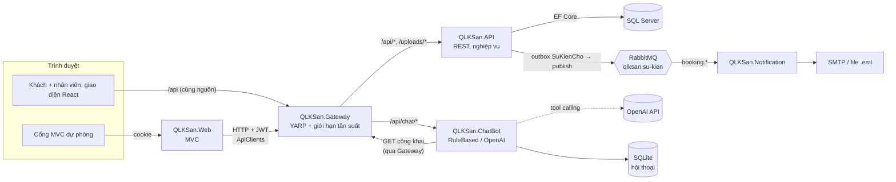
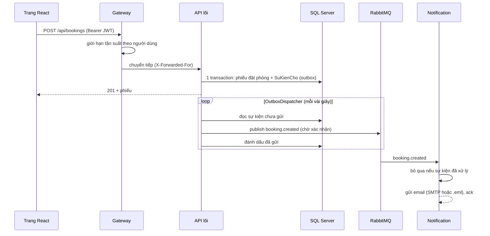
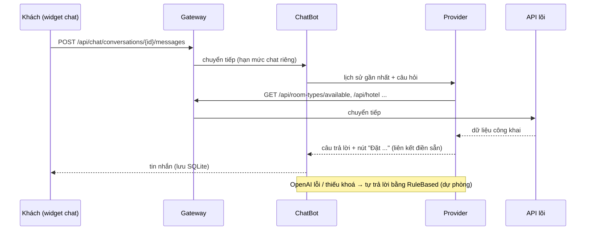

# Kiến trúc hệ thống LUXE RESERVE

Hệ thống đi theo mô hình **RESTful API + ứng dụng web**. Phần mở rộng tách thêm các service nhỏ quanh API lõi. Mọi yêu cầu từ trình duyệt đều đi qua **API Gateway**. API lõi là nơi **duy nhất** đọc và ghi CSDL nghiệp vụ.

## Tổng quan

`QLKSan.Shared` chứa hợp đồng dữ liệu dùng chung cho mọi project .NET: DTO, Request, Enum, Validation, sự kiện. Trang React không dùng trực tiếp project này. Kiểu dữ liệu TypeScript của nó được sinh từ OpenAPI của API lõi (`npm run gen:api`).

## Các service

| Project | Vai trò | Công nghệ | Dev | Docker | Dữ liệu |
|---|---|---|---|---|---|
| `QLKSan.Gateway` | Cổng vào duy nhất: định tuyến, giới hạn tần suất | YARP, RateLimiter | https 7000 | **7080** | — |
| `QLKSan.API` | Nghiệp vụ khách sạn, xác thực JWT | ASP.NET Core, EF Core | https 7001 | nội bộ | SQL Server |
| `QLKSan.Web` | Cổng nhân viên + trang khách MVC (**dự phòng**) | ASP.NET Core MVC | https 7234 | **7081** | khoá cookie |
| `QLKSan.Client` | **Giao diện chính**: trang khách + cổng nhân viên `/nhan-vien`; đường dẫn cũ của MVC tự chuyển sang trang tương ứng | React 19 + TypeScript (Vite), TanStack Query | http 5173 | **7082** (nginx) | — |
| `QLKSan.ChatBot` | Trợ lý ảo cho khách | ASP.NET Core, `ILlmProvider` | https 7004 | nội bộ | SQLite riêng |
| `QLKSan.Notification` | Gửi email theo sự kiện phiếu đặt phòng | Worker + RabbitMQ.Client | http 5003 | nội bộ | thư mục mail |

Trong Docker chỉ Gateway, Web, Client, giao diện quản trị RabbitMQ (15672) và SQL Server (14330, để quản trị) mở cổng ra ngoài.

## Nguyên tắc

1. **Chỉ API lõi truy cập CSDL nghiệp vụ.** Nghiệp vụ nằm trong `QLKSan.API/Business/`, controller mỏng.
   - Web gọi API bằng `ApiClients/`.
   - ChatBot chỉ đọc endpoint công khai.
   - Notification chỉ nhận sự kiện.
2. **Giao tiếp đồng bộ dùng REST qua Gateway, giao tiếp bất đồng bộ dùng RabbitMQ.** Không service nào gọi thẳng vào service khác mà bỏ qua Gateway.
3. **Không cần CORS.** Trang React được phục vụ cùng nguồn với `/api`: Vite proxy khi dev, nginx khi chạy Docker. Token đăng nhập của trang React (khách và nhân viên) nằm trong sessionStorage, nên nginx gửi Content-Security-Policy chặt (chỉ script / API cùng nguồn, font Google Fonts, không cho nhúng khung).
4. **Bí mật không nằm trong mã nguồn.** `Jwt:Key`, chuỗi kết nối, mật khẩu RabbitMQ và khoá OpenAI được đặt bằng biến môi trường hoặc user-secrets.
   - Khoá OpenAI chỉ có ở ChatBot.
   - API và Gateway dừng ngay khi khởi động nếu thiếu khoá.

## Luồng chính

### Khách đặt phòng trên trang React → email xác nhận

Sự kiện được ghi trong **cùng transaction** với dữ liệu nghiệp vụ, nên một phiếu đã lưu thì sự kiện của nó không bao giờ bị mất.
- RabbitMQ ngừng: sự kiện nằm chờ trong `SuKienCho` và được gửi khi kết nối lại.
- Gửi email lỗi: Notification trả sự kiện về hàng đợi để thử lại.

Các loại sự kiện:
- `booking.created`: đặt online, đặt tại quầy, khách vãng lai;
- `booking.cancelled`: khách huỷ, lễ tân huỷ, chốt ngày huỷ phiếu khách không đến;
- `booking.checked-in`.

### Trợ lý ảo

Bot không tự đặt, sửa hay huỷ phòng. Nó trả liên kết tới trang đặt phòng đã điền sẵn hạng phòng, ngày và số khách để khách tự xác nhận. Trang React đổi các liên kết này sang route của chính nó (`/dat-phong`, `/hang-phong/:ma`).

### Nhân viên trên cổng MVC

Trình duyệt giữ cookie đăng nhập của `QLKSan.Web`. JWT do API cấp nằm trong cookie này, được mã hoá bằng DataProtection nên trình duyệt không đọc được. Web gắn JWT vào mỗi lần gọi API qua Gateway, kèm `X-Forwarded-For` để Gateway giới hạn tần suất theo IP thật của người dùng. Phân quyền theo vai trò được kiểm tra ở cả Web (menu, trang) và API (`[Authorize(Roles=...)]`).

## Giới hạn tần suất (Gateway)

| Chính sách | Áp dụng | Mặc định / phút | Khoá đếm |
|---|---|---|---|
| `dang-nhap` | `POST /api/auth/login`, `/api/auth/register` | 20 | IP |
| `chat` | `/api/chat/*` | 20 | người dùng (JWT hợp lệ) hoặc IP |
| `mac-dinh` | mọi `/api/*` khác | 600 | người dùng (JWT hợp lệ) hoặc IP |

Vượt hạn mức thì Gateway trả `429` dạng `application/problem+json` với thông báo tiếng Việt. Gateway chỉ tin `X-Forwarded-For` từ loopback và các mạng khai báo trong `Gateway:MangTinCay`. Token giả hoặc sai khoá được tính như khách chưa đăng nhập, tức là đếm theo IP.

## Kiểm thử

| Phạm vi | Ở đâu | Chạy |
|---|---|---|
| Tính tiền, giá theo mùa, phòng trống, đọc ngày ở tiếng Việt | `QLKSan.Tests` (`BillingCalculatorTests`, `PricingCalculatorTests`, `RoomAvailabilityTests`, `StayParserTests`) | `dotnet test QLKSan.Tests` |
| Trợ lý ảo: chỉ gọi GET công khai, liên kết điền sẵn, tool calling OpenAI, tự chuyển dự phòng | `QLKSan.Tests/ChatBotTests.cs` (API và OpenAI giả lập) | như trên |
| Gateway: định tuyến, hạn mức theo người dùng / IP, 429 | `QLKSan.Tests/GatewayTests.cs` (service giả) | như trên |
| Notification: nội dung email từng loại sự kiện, mã hoá HTML | `QLKSan.Tests/NotificationTests.cs` | như trên |
| Trang React: định dạng, liên kết chatbot, gọi API, tải tệp / tải lên, phiên đăng nhập (khách + nhân viên), menu và phân quyền cổng nhân viên (khớp sidebar MVC), mọi mục menu có trang, chuyển hướng đường dẫn MVC cũ, các phép tính hiển thị (kế toán, chốt ngày, khuyến mãi) | `QLKSan.Client/src/**/*.test.ts` (Vitest) | `npm test` |
